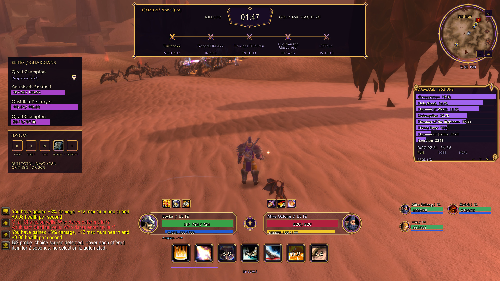
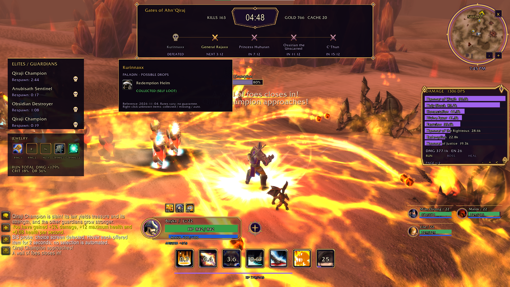
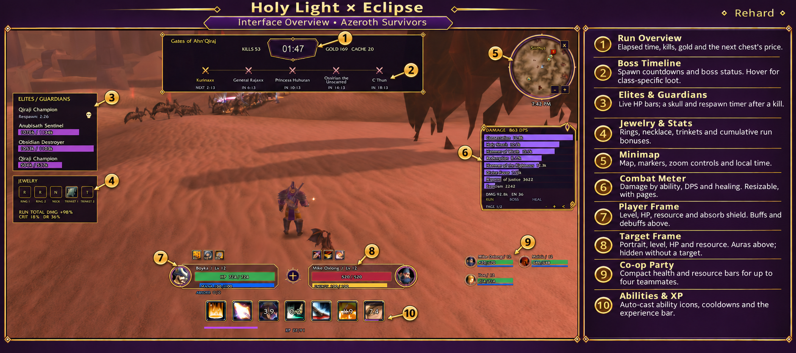

# Holy Light × Eclipse — 0.9.5

A gold-and-violet HUD for Azeroth Survivors. **By Rehard.**

[Download the latest packaged addon](https://github.com/challangeguild-ai/HolyLightEclipse/releases/download/v0.9.5/HolyLightEclipse-0.9.5.zip) · [Release notes](https://github.com/challangeguild-ai/HolyLightEclipse/releases/tag/v0.9.5) · [Screenshots](#screenshots) · [SHA-256](downloads/SHA256SUMS-0.9.5.txt)

## Screenshots

These two images are unaltered, player-supplied screenshots of the current 0.9.5 addon in desktop gameplay. They are examples from one player's setup, not proof of every feature or platform.

### Full HUD and co-op party

### Boss loot on hover

### English interface guide — explanatory illustration

**AI-edited annotation based on a player screenshot.** The guide explains the numbered regions; its reconstructed game text and numbers are not an unaltered gameplay capture. Use the two original images above when you need authentic in-game screenshots.

## Features

- Fixed player frame with HP, power, level, XP and supported absorb information; mirrored target frame, hidden when no target exists.
- Player and target buffs/debuffs above their respective frames.
- Compact auto-cast ability icons and current-run cooldowns; reset handling between runs.
- One upper run panel with the run clock, kills, gold, next chest price and boss timeline. Crossed swords indicate upcoming/alive bosses; skulls use reported defeated states. The countdown follows run time and pauses with the game.
- Separate boss HP bars below the timeline, without aura rows. Elite/guardian HP stays in the left lair list; observed deaths show a skull and reported respawn time.
- Class-specific boss-loot panels on timeline hover: a dated reference for 65 bosses and nine classes. Recorded self-loot/equipped evidence and explicit manual collected/missing marks are kept distinct.
- A draggable combat meter with RUN/BOSS/HEAL tabs, 4–16 visible rows, pagination and independently adjustable width.
- Five jewelry slots, native item tooltips, run-wide bonuses and an observed-item diary.
- Compact co-op frames for up to four teammates (five players including yourself).
- A matching minimap skin, native zoom controls and local clock where supported.
- Custom nameplates, optional outgoing damage text and received-healing feedback where the necessary APIs exist.
- Matching loot notifications, narrower chat, movable panels and saved layout profiles.

## Install or update

Download **HolyLightEclipse-0.9.5.zip** from the release above. Close the game and extract its single `HolyLightEclipse` folder into the game's AddOns folder. In the native client used for development, this is `benilla-config/AddOns/`; use the game's Open AddOns Folder option if available.

The layout must be `AddOns/HolyLightEclipse/HolyLightEclipse.toc`, with no extra nested folder. For an Interface-based loader, use `Interface/AddOns/HolyLightEclipse/` instead. Replace the previous addon folder when updating; you do not need to erase your saved settings. Disable overlapping full HUD replacements.

The TOC declares `## Interface: 11200`. This targets the Azeroth Survivors client API; it is not a general vanilla WoW or modern WoW addon. Browser installation is **not verified** for this release. GitHub's automatically generated source archives are not the recommended install package.

## Controls

- `/hle` — HUD controls; `/hle unlock` and `/hle lock` — move/lock supported panels. The meter remains draggable.
- `/hle meter rows 10` and `/hle meter width 340` — meter size; its `+`/`−` and `<`/`>` controls change rows and pages.
- `/hle meter run`, `/hle meter boss`, `/hle meter heal` — meter views.
- Hover a boss name or icon in the timeline for your class's possible gear drops.
- Right-click an **unconfirmed** drop: collected → missing → automatic/unknown. Confirmed self-loot/equipped evidence is not overwritten by this toggle.
- `/hle damage`, `/hle healing` — toggle optional outgoing damage / received-healing text.
- `/hle off` — disable the HUD and restore native elements it owns; `/hle status` — diagnostics.

## Accuracy and known limits

- Boss loot is a **static reference retrieved on 4 November 2026**, not a live query of every game's drop table. Updates can change it. No drop percentages or guaranteed drops are claimed. Sources: [manifest](HolyLightEclipse/BossLoot-reference.json) and [source notes](HolyLightEclipse/SOURCES.md).
- There is no verified complete Collection getter. **UNKNOWN does not mean missing.** Positive observations are stored by class and character name; this diary does not automatically synchronize the full historical collection or detect every imported/reset save. Manual marks are labelled separately. The panel covers the catalogued permanent class gear, not every random ring/trinket roll.
- Before a run starts, boss times show `--:--` instead of an unverified default/cached schedule. Live countdowns start with the active schedule. Cached names are plans, not proof of current boss states.
- There is no verified general threat table or stable legacy nameplate-to-unit binding. Red/yellow/green victim-based colouring is only used for an unambiguous target with supported native data. Unknown threat remains neutral; it is not a prediction of an aggro change.
- Outgoing custom text requires the supported combat-event/projection API. Received-healing feedback is a positive change in the game's effective-healing total, not a per-cast prediction or an overheal display.
- User screenshots and feedback document desktop use. Automated checks cover files, XML, textures and a restricted Lua 5.1/mock API regression suite; **not a real Lua 5.0 interpreter, every class, every feature or browser gameplay**. See [verification](docs/Verification-0.9.5.txt). The exact build used for the supplied screenshots was not recorded.

[Detailed Hungarian changelog and instructions](HolyLightEclipse/README-HU.md) · [Source and attribution notes](HolyLightEclipse/SOURCES.md)
